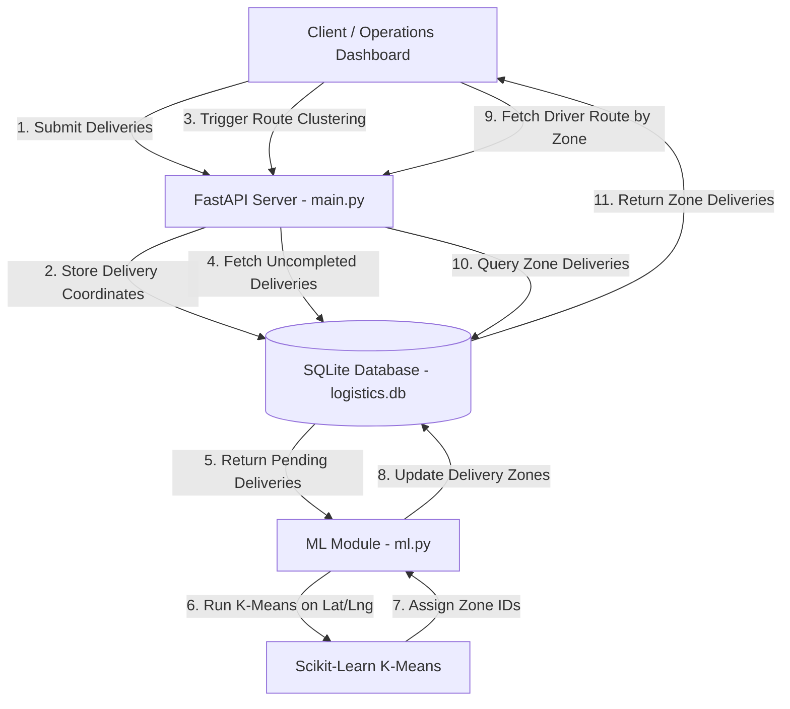
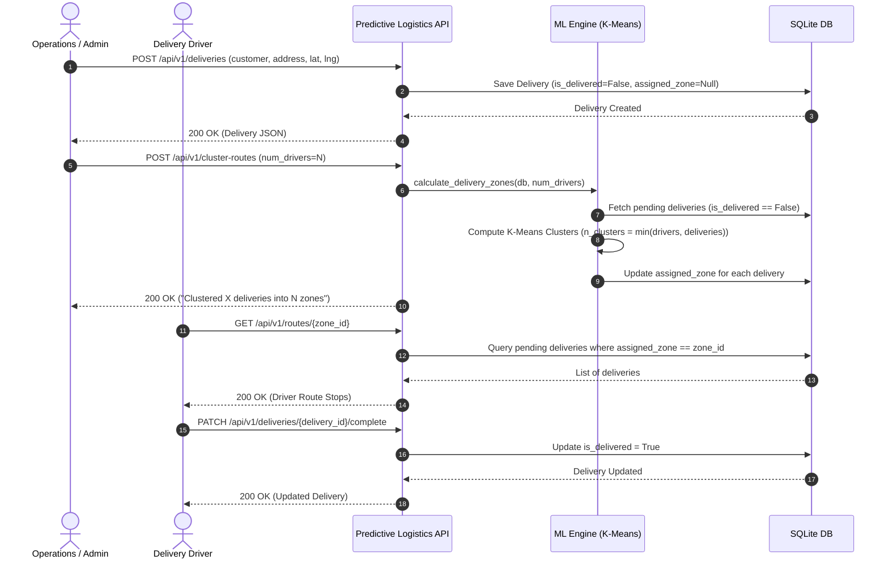

# Predictive Logistics API 🚚📍

A high-performance FastAPI service designed to dynamically cluster and optimize delivery routes using Machine Learning (**K-Means Clustering** via Scikit-Learn).

---

## 🌟 Overview

The **Predictive Logistics API** streamlines delivery operations by automatically grouping geographic delivery stops (latitude & longitude) into optimized driver zones based on the available fleet size.

* **Framework:** [FastAPI](https://fastapi.tiangolo.com/) (Python 3.10+)
* **Database:** SQLite with [SQLAlchemy ORM](https://www.sqlalchemy.org/)
* **Validation:** [Pydantic v2](https://docs.pydantic.dev/)
* **Machine Learning:** [Scikit-Learn](https://scikit-learn.org/) (K-Means Clustering) & NumPy

---

## 🏗️ System Architecture & Workflow

### 1. Data Flow & Clustering Architecture



---

### 2. Delivery Lifecycle Sequence



---

## 📁 Project Structure

```text
predictive-logistics-api/
├── main.py          # FastAPI application & API route definitions
├── database.py      # SQLAlchemy database engine & session setup
├── models.py        # SQLAlchemy ORM models (DeliveryStop)
├── schemas.py       # Pydantic schemas for request & response validation
├── ml.py            # ML clustering logic using Scikit-Learn K-Means
├── requirements.txt # Python package dependencies
└── logistics.db     # SQLite database storage (auto-generated)
```

---

## 🚀 Getting Started

### Prerequisites

* Python 3.10 or higher
* `pip` and `virtualenv`

### Installation

1. **Clone or navigate to the project directory:**
   ```bash
   cd predictive-logistics-api
   ```

2. **Create and activate a virtual environment:**
   ```bash
   python -m venv venv
   source venv/bin/activate
   ```

3. **Install dependencies:**
   ```bash
   pip install -r requirements.txt
   ```

### Running the API Server

Start the server using `uvicorn` with auto-reload:

```bash
uvicorn main:app --reload
```

The service will run on `http://localhost:8000`. You can access:
* **Interactive API Docs (Swagger UI):** [http://localhost:8000/docs](http://localhost:8000/docs)
* **Alternative API Docs (ReDoc):** [http://localhost:8000/redoc](http://localhost:8000/redoc)

---

## 🔌 API Endpoints Summary

| Method | Endpoint | Description |
| :--- | :--- | :--- |
| `GET` | `/health` | Server status and pending delivery count |
| `POST` | `/api/v1/deliveries` | Create a new delivery request |
| `GET` | `/api/v1/deliveries` | List all uncompleted/pending deliveries |
| `POST` | `/api/v1/cluster-routes` | Cluster pending deliveries into driver zones via ML |
| `GET` | `/api/v1/routes/{zone_id}` | Fetch assigned pending deliveries for a specific driver zone |
| `PATCH` | `/api/v1/deliveries/{id}/complete` | Mark a delivery stop as completed |

---

## 🧪 Example API Usage

### 1. Ingest New Deliveries

```bash
curl -X POST http://localhost:8000/api/v1/deliveries \
     -H "Content-Type: application/json" \
     -d '{
       "customer_name": "Ravi Patel",
       "address": "Jubilee Ground",
       "latitude": 23.2501,
       "longitude": 69.6610
     }'
```

### 2. Cluster Deliveries into Driver Zones

Group all unassigned, pending deliveries into `2` driver zones:

```bash
curl -X POST http://localhost:8000/api/v1/cluster-routes \
     -H "Content-Type: application/json" \
     -d '{"num_drivers": 2}'
```

### 3. Fetch Deliveries for Zone 1

```bash
curl http://localhost:8000/api/v1/routes/1
```

### 4. Mark Delivery as Completed

```bash
curl -X PATCH http://localhost:8000/api/v1/deliveries/1/complete
```

---

## 📊 Database Schema (`DeliveryStop`)

| Field | Type | Description |
| :--- | :--- | :--- |
| `id` | `Integer` | Primary Key (Auto-incremented) |
| `customer_name` | `String` | Customer name |
| `address` | `String` | Delivery street address |
| `latitude` | `Float` | Geographic latitude |
| `longitude` | `Float` | Geographic longitude |
| `is_delivered` | `Boolean` | Completion status (`default=False`) |
| `assigned_zone` | `Integer` | Driver zone index assigned by K-Means (`Nullable`) |
